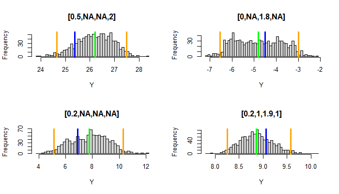
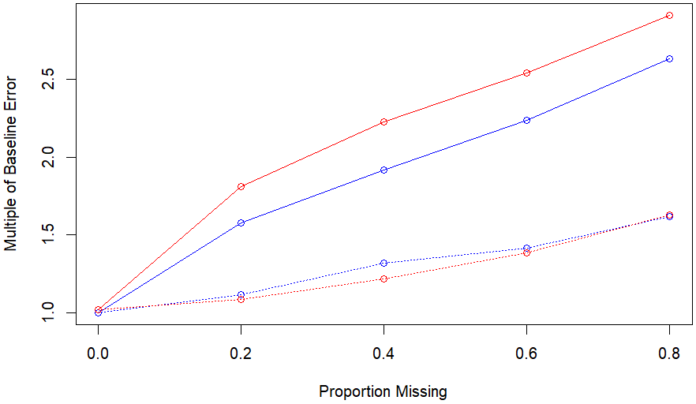
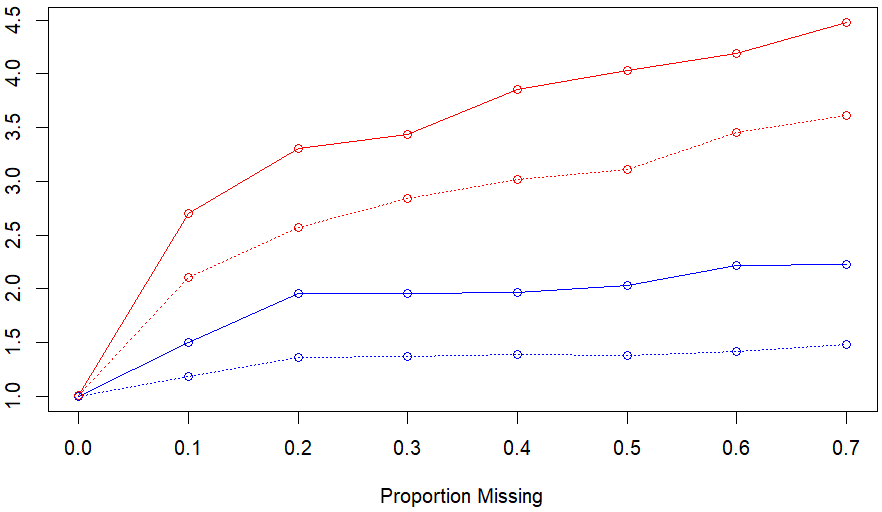
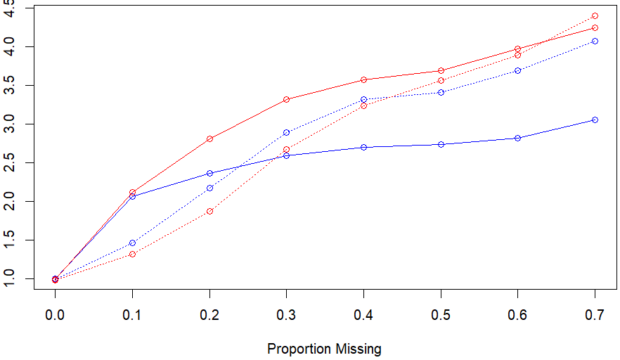

# Missing data in BART: Missing Incorporated in Attributes

Simulation code of the project *Incorporare dati mancanti nel Bayesian Additive Regression Trees*
(Giacomo Grossi and Andrea Toccafondi, University of Florence, December 2025). The slides, in
Italian, are in [`docs/presentation.pdf`](docs/presentation.pdf).

BART (Chipman, George and McCulloch, 2010) models y = f(x) + ε as a sum of regression trees.
Kapelner and Bleich (2015) let BART handle **missing covariates without imputation**, both in
training and in prediction, through *Missing Incorporated in Attributes* (MIA): at every split on
x<sub>j</sub> ≤ c the tree also chooses where the missing values go,

1. x<sub>j</sub> ≤ c or missing → left, otherwise right;
2. x<sub>j</sub> ≤ c → left, x<sub>j</sub> > c or missing → right;
3. missing → left, observed → right.

The model then targets E[Y | X<sub>obs</sub>, M], with M the missingness indicators. We study it by
simulation with the `bartMachine` package, under the three missing-data mechanisms of Rubin (1976)
and under the two factorizations of Little (1993).

## Data-generating process

Y = g(X<sub>1</sub>, X<sub>2</sub>, X<sub>3</sub>, X<sub>4</sub>) + ε, ε ~ N(0, 1), with

g = X<sub>1</sub> + X<sub>2</sub> + 2X<sub>3</sub> − X<sub>1</sub>² + X<sub>2</sub>² + X<sub>1</sub>X<sub>2</sub> + X<sub>3</sub>X<sub>4</sub> + √X<sub>4</sub>,

(X<sub>1</sub>, X<sub>2</sub>, X<sub>3</sub>) trivariate normal with mean (0, 1, 2) and correlated components,
X<sub>4</sub> ~ Poisson(1).

## Experiments

**Pattern-mixture model** (`R/pattern_mixture.R`). Missingness changes the response:
Y = g + B·M<sub>3</sub> + S·M<sub>4</sub> + ε with B ~ N(10, 1) and S ~ U(−20, −10). X<sub>2</sub> is missing
with probability 0.3 when X<sub>2</sub> > 0, X<sub>3</sub> with probability 0.3 when X<sub>1</sub> > 0, X<sub>4</sub>
completely at random with probability 0.15 (n = 2000). BART-MIA is fitted once and, at a few
covariate patterns with missing entries, the posterior of the prediction is compared with the true
conditional expectation. Over 100 simulations the true value fell inside the 95% credible interval
in 77% of the runs for (0.5, NA, NA, 2), 93% for (0, NA, 1.8, NA), 75% for (0.2, NA, NA, NA) and
99% for the fully observed (0.2, 1, 1.9, 1).



*Posterior of the prediction (histogram), its mean (green), 95% credible interval (orange) and the
true expectation (blue).*

**Selection models** (`R/selection_mcar.R`, `R/selection_mar.R`, `R/selection_nmar.R`). The response
no longer depends on M; the out-of-sample RMSE is tracked as the proportion of missing data grows,
relative to the error with no missing data, for four combinations:

| Curve | Training set | Test set |
|---|---|---|
| blue, solid | with missing values (BART-MIA) | with missing values |
| blue, dotted | with missing values (BART-MIA) | complete |
| red, solid | complete cases only | with missing values |
| red, dotted | complete cases only | complete |

- **MCAR**: every covariate is missing independently with probability γ.
- **MAR**: X<sub>3</sub> is missing with probability Φ(β<sub>0</sub> + βX<sub>1</sub> + βX<sub>2</sub>²), X<sub>4</sub> with
  probability Γ when X<sub>1</sub> > 0.
- **NMAR**: X<sub>2</sub> is missing with probability Φ(β<sub>0</sub> + βX<sub>1</sub>² + βX<sub>2</sub>) when X<sub>2</sub> > 0,
  X<sub>4</sub> with probability Γ when X<sub>4</sub> > 1.

| MCAR | MAR | NMAR |
|---|---|---|
|  |  |  |

*Multiple of the baseline RMSE against the proportion of missing data.* Training BART-MIA on all the
data (blue) keeps the error well below that of the complete-case model (red) under all three
mechanisms.

## Repository

| File | Content |
|---|---|
| `R/pattern_mixture.R` | pattern-mixture simulation and posterior histograms at four covariate patterns |
| `R/pattern_mixture_diagnostics.R` | the same fit with MCMC diagnostics for σ² (trace, ACF, running mean), variable inclusion proportions and a short-burn-in comparison |
| `R/selection_mcar.R`, `R/selection_mar.R`, `R/selection_nmar.R` | RMSE against the proportion of missing data under MCAR, MAR and NMAR |
| `docs/presentation.pdf` | the slides (Italian) |
| `figures/` | figures from the slides |

## Running

The scripts need Java and the R packages `rJava`, `bartMachine`, `MASS` and `mvtnorm`. Each script
starts by setting `JAVA_HOME` to a Windows path: change it to your Java installation, or delete the
line if R already finds Java.

```r
install.packages(c("rJava", "bartMachine", "MASS", "mvtnorm"))
source("R/selection_mcar.R")
```

The selection-model scripts save their results to `sec_4.2_*.RData` after every replication.

## References

- H. A. Chipman, E. I. George and R. E. McCulloch (2010). BART: Bayesian additive regression trees.
  *The Annals of Applied Statistics*, 4(1), 266–298.
- A. Kapelner and J. Bleich (2015). Prediction with missing data via Bayesian additive regression
  trees. *Canadian Journal of Statistics*, 43(2), 224–239.
- A. Kapelner and J. Bleich (2016). bartMachine: Machine learning with Bayesian additive regression
  trees. *Journal of Statistical Software*, 70(4).
- R. J. A. Little (1993). Pattern-mixture models for multivariate incomplete data. *Journal of the
  American Statistical Association*, 88(421), 125–134.
- D. B. Rubin (1976). Inference and missing data. *Biometrika*, 63(3), 581–592.

## License

MIT
